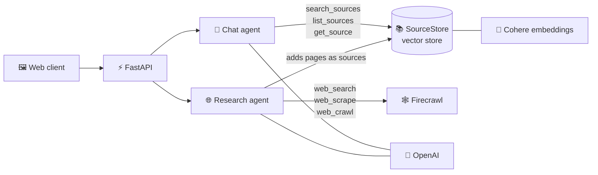

<h1 align="center">📓 langchain-notebooklm</h1>

<p align="center">
  A NotebookLM-style <b>grounded research assistant</b> built with <b>LangChain v1</b>.<br/>
  Add your own sources, search the web, and chat with answers that cite where they came from.
</p>

<p align="center">
  
  
  
  
  
  
</p>

---

## 📋 Table of contents

- [✨ Features](#-features)
- [🧰 Tech stack](#-tech-stack)
- [🚀 Quick start](#-quick-start)
- [🔑 Configuration](#-configuration)
- [🕹️ How to use](#️-how-to-use)
- [🏗️ Architecture](#️-architecture)
- [📁 Project structure](#-project-structure)
- [🗺️ Roadmap](#️-roadmap)

---

## ✨ Features

| | Feature | What it does |
|---|---|---|
| 📚 | **Sources** | Paste text, upload `.md` / `.txt` files, or search the web. Turn sources on or off, view or delete them. |
| 💬 | **Grounded chat** | An agent answers only from your active sources and shows which ones it used. Remembers the conversation. |
| 🌐 | **Web research** | A research agent writes several search queries, picks credible pages and scrapes them with Firecrawl. |
| 🙋 | **Human in the loop** | Optionally review the pages the agent proposes and choose which ones to add. |
| 📝 | **Notes** | Save any answer as a note. |
| 🎨 | **Studio** | Infographic, PowerPoint, Summary and FAQ are planned (the UI shows "coming soon"). |

## 🧰 Tech stack

| Layer | Technology |
|---|---|
| 🤖 Chat model | OpenAI — `openai:gpt-4o` by default |
| 🧮 Embeddings | Cohere — `embed-multilingual-v3.0` by default |
| 🕸️ Web sources | Firecrawl — search, scrape and crawl |
| ⛓️ Agents | LangChain v1 — `create_agent`, tools, checkpointer, `HumanInTheLoopMiddleware` |
| ⚡ Backend | FastAPI + Uvicorn |
| 🖼️ Frontend | Plain HTML / CSS / JS (no build step) |
| 📦 Tooling | `uv` for dependencies |

## 🚀 Quick start

**Requirements:** Python 3.13+ and [`uv`](https://docs.astral.sh/uv/).

```bash
uv sync                      # 1. install dependencies
cp .env.example .env         # 2. create your env file (PowerShell: Copy-Item .env.example .env)
uv run notebooklm-serve      # 3. start the app, then open http://127.0.0.1:4040
```

Try the chat agent from the terminal, without the server:

```bash
uv run notebooklm
```

## 🔑 Configuration

Copy [`.env.example`](.env.example) to `.env` and fill in the keys:

| Variable | Required | Purpose |
|---|:---:|---|
| `OPENAI_API_KEY` | ✅ | Chat model |
| `COHERE_API_KEY` | ✅ | Embeddings for semantic search |
| `FIRECRAWL_API_KEY` | ⬜ | Web search. Without it the free, rate-limited tier is used (crawl needs a key). |
| `NOTEBOOKLM_CHAT_MODEL` | ⬜ | Override the chat model, e.g. `openai:gpt-4o` |
| `NOTEBOOKLM_EMBEDDING_MODEL` | ⬜ | Override the embedding model |
| `NOTEBOOKLM_PORT` | ⬜ | Change the server port (default `4040`) |

> 🔒 `.env` is git-ignored. Never commit your keys.

## 🕹️ How to use

1. ➕ Click **+ Add** and paste text, upload a file, or search the web for a topic.
2. 🙋 For web search, keep **Let me choose the pages** ticked to review the proposed pages and add only the ones you want. Untick it to let the agent choose.
3. 💬 Ask questions in the chat. Answers are grounded in the active sources and cite them.
4. ☑️ Untick a source to leave it out of answers, or delete it to remove it completely.
5. 📝 Click **Save to note** on any answer you want to keep.

## 🏗️ Architecture

The app is a three-panel workspace with a real client/server split:

```
┌──────────────────┬──────────────────┬─────────────────┐
│ SOURCES          │ CHAT             │ STUDIO          │
├──────────────────┼──────────────────┼─────────────────┤
│ add / upload     │ grounded answers │ artifacts       │
│ web search       │ with citations   │ + saved notes   │
│ select / delete  │                  │                 │
└──────────────────┴──────────────────┴─────────────────┘
```



**💬 Chat agent** — one agent with three tools over the active sources:
`search_sources` (semantic search), `list_sources` and `get_source`. History is kept per
`thread_id` with an in-memory checkpointer, and the sources it used are returned as citations.

**🌐 Research agent** — plans several search queries, picks credible pages and scrapes them.
In review mode, `HumanInTheLoopMiddleware` pauses before each scrape so you can approve or reject
every proposed page.

## 📁 Project structure

```
📁 notebooklm-starter
├── 🖼️ client/              web client: single-page HTML / JS / CSS, no build step
├── 📁 src/
│   ├── 🐍 app.py          try the chat agent from the terminal
│   ├── 🤖 agents/
│   │   ├── chat.py         chat agent: tools + short-term memory
│   │   └── research.py     web research agent: Firecrawl tools + human-in-the-loop
│   ├── 🧠 core/
│   │   ├── sources.py      chunking and formatting of documents
│   │   └── store.py        SourceStore: sources + in-memory vector store
│   └── ⚡ api/
│       ├── app.py          FastAPI routes
│       ├── schemas.py      Pydantic models (the API contract)
│       ├── services.py    glue between the API and the agents
│       └── serve.py        server entry point
├── ⚙️ pyproject.toml       dependencies and scripts
└── 🔑 .env.example        environment template
```

## 🗺️ Roadmap

| Status | Feature | Where |
|:---:|---|---|
| ✅ | Basic chat agent + memory | `agents/chat.py` |
| ✅ | Retrieval (grounded Q&A, RAG) | `core/store.py`, `core/sources.py` |
| ✅ | Agent tools | `search_sources`, `list_sources`, `get_source` |
| ✅ | Web sources (search / scrape / crawl) | `agents/research.py` |
| ✅ | Human in the loop (choose pages to scrape) | `HumanInTheLoopMiddleware` |
| ⏳ | Studio artifacts (structured output) | planned |
| ⏳ | Event streaming | planned |
| ⏳ | Guardrails | planned |
| ⏳ | MCP | planned |

